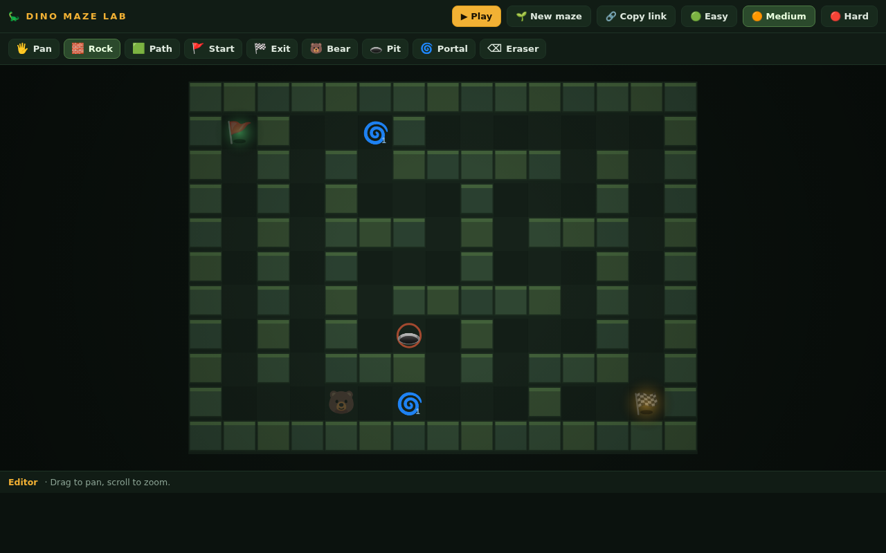
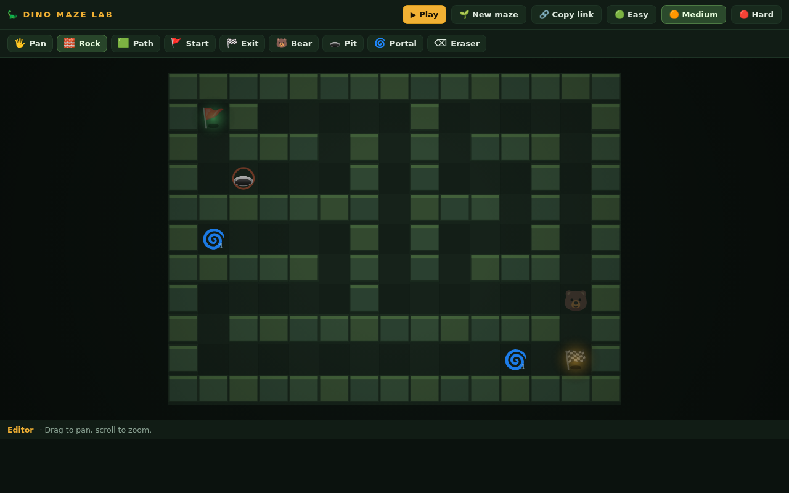
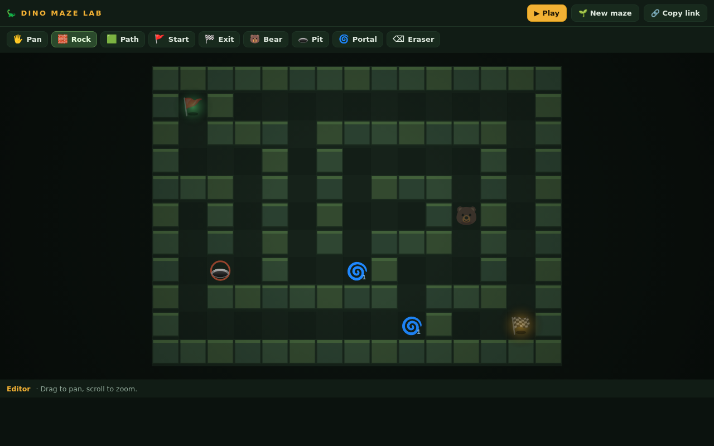

# 🦕 Dino Maze Lab

A browser-based 2D top-down maze **creator + player** with a Jurassic Park theme — built by a parent and their 7-year-old son.

Paint rock walls, drop dinos 🦖, pit traps 🕳️, sticky triangles 🔺 and paired portals 🌀, then hit **▶ Play** and walk your ranger 🤠 to the exit 🏁. Every maze lives entirely in its URL — copy the link and a friend plays your exact maze.

## Run it

No install, no build step. Just open `index.html` in a browser (double-click), or serve it:

```bash
python3 -m http.server 8000
# → http://localhost:8000
```




## How to play

- **Editor**: pick a tool (Rock, Path, Start, Exit, Dino, Pit, Portal, Triangle, Eraser) and paint. Drag with 🖐 to pan, scroll to zoom.
- **Difficulty**: 🟢 Easy / 🟠 Medium / 🔴 Hard buttons generate a fresh auto-maze of that level.
- **Play**: arrow keys / WASD. Avoid dinos and pits — 🔺 triangles stick you for 3 seconds, step on a portal to teleport.
- **Share**: 🔗 Copy link sends the whole maze in the URL hash.

Exactly one 🚩 start and one 🏁 exit per maze — enforced by design.

## Deploy

Static file → any static host. On Vercel: import the repo, framework **Other**, no build command, output `./`. Every push redeploys.



## Docs

Full design doc, architecture, roadmap and known issues: [`PROJECT.md`](./PROJECT.md).

## Stack

Vanilla JS + HTML5 Canvas. Zero dependencies, zero build. The kid can read the code.